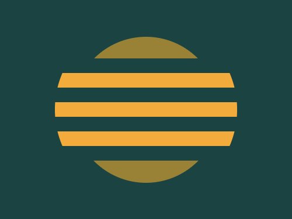
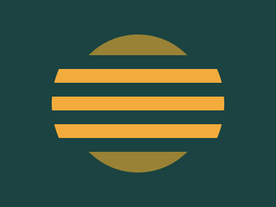

# #39. Sunset

Challenge: <https://cssbattle.dev/play/39>

## Result

<table>
	<tr>
		<th width="50%">User Submission</th>
		<th width="50%">Target</th>
	</tr>
	<tr>
		<td width="50%" align="center">
			
		</td>
		<td width="50%" align="center">
			
		</td>
	</tr>
</table>

## Code

```html
<div class = "container">
  <div class = "small-circle"></div>
  <div class = "square"></div>
  <div class = "rectangle"></div>
  <div class = "big-circle"></div>
</div>
<style>
  * {
    margin: 0;
    padding: 0;
  }
  .container {
    width: 400px;
    height: 300px;
    background: #1A4341;
    display: flex;
    justify-content: center;
    align-items: center;
  }
  .small-circle {
    position: absolute;
    width: 200px;
    height: 200px;
    background: #998235;
    border-radius: 50%;
  }
  .square {
    position: absolute;
    width: 200px;
    height: 140px;
    background: #1A4341;
  }
  .rectangle {
    position: absolute;
    width: 250px;
    height: 100px;
    background: linear-gradient(to bottom, #F3AC3C 0 20%, #1A4341 20% 40%, #F3AC3C 40% 60%, #1A4341 60% 80%, #F3AC3C 80% 100%);
  }
  .big-circle {
    position: absolute;
    width: 250px;
    height: 250px;
    border: 10px solid #1A4341;
    border-radius: 50%;
  }
</style>
```
